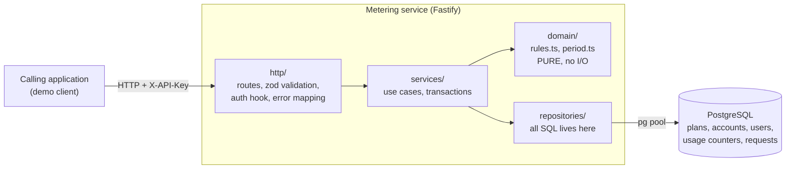

# Architecture

One Node/TypeScript service and one PostgreSQL database (the brief's minimum). The interesting design is *inside* the service: strict layers and a pure core.



## Layers and the one rule
`http → services → (domain, repositories)`; `domain` imports nothing.
| Layer | Folder | Does | Does not |
|---|---|---|---|
| HTTP | `src/http` | Parse and validate input (zod), authenticate, map errors to JSON | Business rules, SQL |
| Services | `src/services` | One function per use case; open transactions; orchestrate | Know about HTTP or SQL text |
| Domain | `src/domain` | Decide "which rule rejects this?", month math, error types | I/O of any kind |
| Repositories | `src/repositories` | SQL statements, row-to-object mapping | Decisions |
| DB | `src/db` | Pool, migrations, seed | |

Why it matters: the decision logic is a pure function, so it is tested with a truth table and explained in one file; the locking behaviour is concentrated in one service + two repositories, so it can be audited in minutes.

## Request lifecycle: `POST /consume`
```mermaid
sequenceDiagram
  participant C as Calling app
  participant H as http (Fastify)
  participant S as services/consume
  participant D as domain/rules
  participant DB as PostgreSQL
  C->>H: POST /consume + X-API-Key
  H->>DB: look up account by sha256(key)
  H->>H: validate body (zod)
  H->>S: consume(accountId, userId, units, requestId)
  S->>S: per-account gate (wait in memory, not in the pool)
  S->>DB: BEGIN; lock the account's counter row for the month
  S->>DB: read user, usage, both plans, earlier decision for this requestId
  alt earlier decision exists (a retry)
    S-->>H: replayed result (same answer) or 409 if the payload differs
  else unknown user
    S-->>H: 404
  else first time
    S->>D: evaluate(units, user, account)
    D-->>S: violations (empty = accepted)
    S->>DB: one statement: log the decision (+ add units to both counters if accepted); COMMIT
    S-->>H: result
  end
  H-->>C: 200 {accepted, rule, level, remaining...}
```
Details and reasoning: [CONCURRENCY.md](CONCURRENCY.md).

## Folder map
```
service/src
  main.ts            boot: config, pool, migrate, seed, listen, graceful shutdown
  config.ts          validated environment
  db/                pool.ts  migrate.ts  seed.ts  sql/001_init.sql
  domain/            rules.ts  period.ts  errors.ts  types.ts
  repositories/      accounts users plans usage requests  (+ db.ts: withTx)
  services/          accounts users plans consume usage apiKeys accountGate
  http/              app.ts auth.ts errors.ts pagination.ts schemas.ts routes/*
service/test         unit (rules), integration (real Postgres), concurrency
docs/                this documentation set
```

## Cross-cutting
- **Auth:** `X-API-Key` -> sha256 -> indexed lookup -> `req.account`. All handlers scope by `req.account.id`, never by client-supplied account ids.
- **Config:** validated at boot with zod; the process refuses to start on bad config.
- **Startup:** wait for the database (bounded retry, so a database that is still starting does not crash the service), run migrations under a Postgres advisory lock, upsert the predefined plans. Safe on every boot and from several instances; Compose restarts the service if it exits.
- **Shutdown:** SIGTERM stops accepting requests, lets in-flight transactions finish, closes the pool.
- **Observability:** structured JSON logs (pino) with a request id; `/health` (liveness) and `/ready` (DB reachable).
- **Horizontal scaling:** nothing the service holds in memory is needed for correctness (the per-account gate is only a performance guard), so more copies can run against the same database; correctness comes from the database lock, not from the process.
