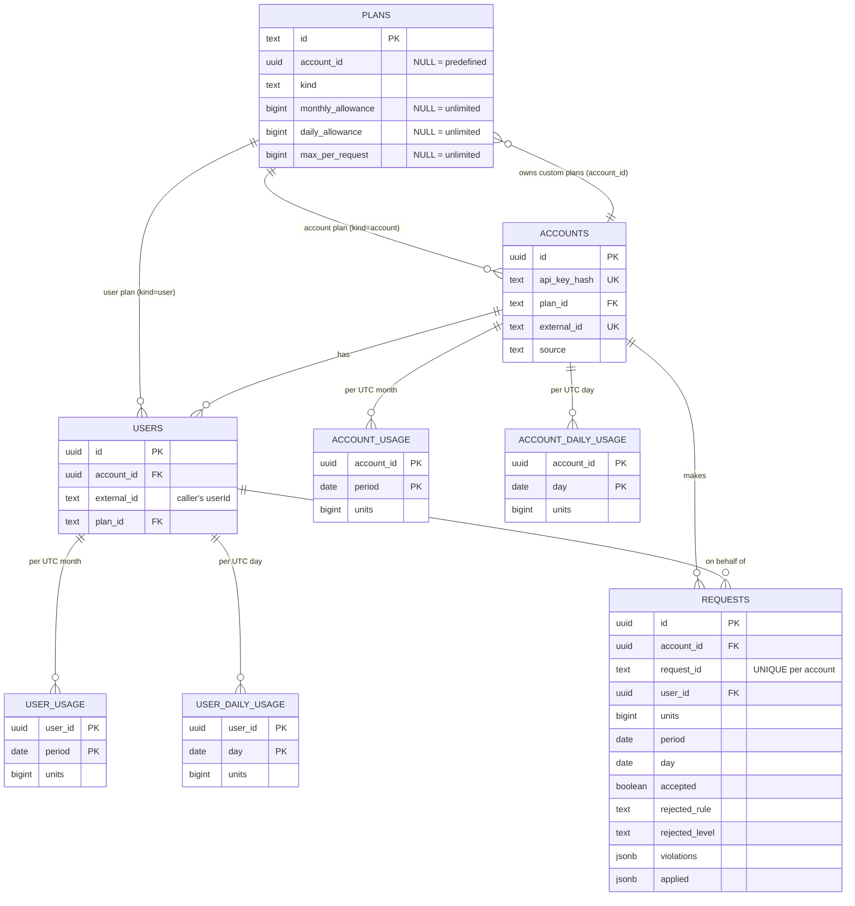

# Data model

Schema: [`service/src/db/sql/001_init.sql`](../service/src/db/sql/001_init.sql). The database enforces as much as it can, so no code path can store a bad state.

## Tables
| Table | Role |
|---|---|
| `plans` | Rule sets (`monthly_allowance`, `daily_allowance`, `max_per_request`). `account_id IS NULL` = predefined (read-only). `kind` is `account` or `user`. A `NULL` limit = unlimited. Plan edits are plain `UPDATE`s, so changes need no redeploy. |
| `accounts` | A calling application. Stores only `sha256(api_key)`. `external_id` is the caller's own customer id (optional, unique when set): it makes provisioning idempotent. `source` records how the account came to exist (`admin` or `self_service`) so self-service accounts can be counted and capped. |
| `users` | A user of an account. `(account_id, external_id)` is unique; `external_id` is the caller's own `userId`. |
| `account_usage` / `user_usage` | Running totals, one row per owner per UTC month (`period` = first day of the month). **Not keyed by plan**, so a plan switch cannot reset usage. |
| `account_daily_usage` / `user_daily_usage` | The same for the **daily allowance** (the extra rule, [ADR-007](decisions/ADR-007-daily-allowance.md)): one row per owner per UTC day (`day`). Also not keyed by plan. |
| `requests` | Every decision: the idempotency record, the audit trail, and the source of truth the counters are checked against. `applied` snapshots the limits and balances used; `day` is the UTC day the decision was charged to (so the daily counters can be re-derived from the log). A row is written with its final decision in one statement (`accepted` is `NOT NULL`, migration 002). |

## Constraints worth knowing
| Constraint | What it guarantees |
|---|---|
| `accounts (plan_id, plan_kind) -> plans (id, kind)` with `plan_kind = 'account'` | The database refuses a user plan on an account (and vice versa on users). |
| `UNIQUE (account_id, request_id)` on `requests` | Idempotency: one decision per request id per account, even under races. |
| `CHECK (period = date_trunc('month', period))` | Usage rows can only be month starts. |
| `CHECK (units >= 0)` on counters, `units BETWEEN 1 AND 1e9` on requests | No negative or absurd values. |
| Limit `CHECK`s (`1..1e12`, `1..1e9`) | Keeps every BIGINT inside a JS number. |
| `CHECK` on `requests` outcome columns | An accepted row has no rejection reason; a rejected row always has one. |
| `UNIQUE INDEX plans (owner, lower(name))` | No duplicate plan names per account (predefined count as one shared owner). |
| `UNIQUE (api_key_hash)` | Indexed O(1) key lookup, and no two accounts share a key. |
| partial `UNIQUE (external_id) WHERE external_id IS NOT NULL` | One account per caller-supplied customer id, so a retried provisioning call cannot create a duplicate (race-safe via `ON CONFLICT`). |
| `CHECK (source IN ('admin', 'self_service'))` | Only the two known origins. |

## Indexes
`requests (account_id, created_at DESC, id DESC)` serves the account's history and cursor pagination; `requests (user_id, created_at DESC, id DESC)` serves per-user history; the usage tables' primary keys serve every counter lookup and lock.

## Invariants (checked by tests from the DB)
- **I1** every counter (monthly and daily) = sum of accepted units in `requests` for that owner and month / day
- **I5** `account_usage` = sum of its users' `user_usage` for that month, and likewise per day
(I2-I6 and how they hold: see [CONCURRENCY.md](CONCURRENCY.md).)
